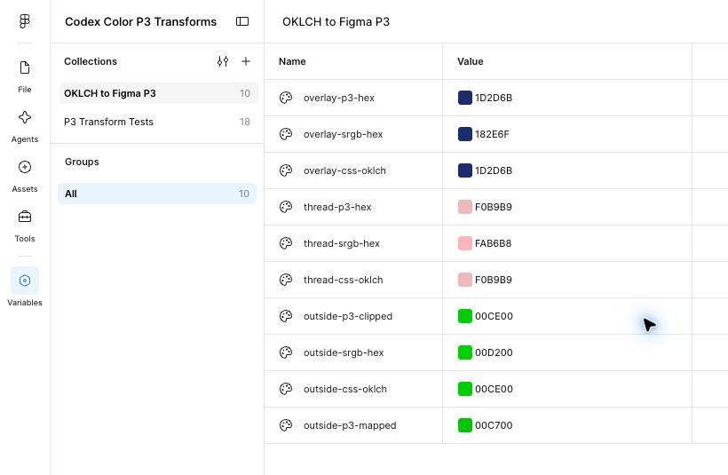

# Перенос цвета из кода в Figma

Перенос через штатный JSON-импорт Variables исследован отдельно: [формат, профиль и приоритет компонентов](variables-json.md). Поддержка OKLCH в CSS-поле палитры не переносится на JSON `colorSpace: "oklch"`.

Для HEX-поля переменной в документе Display-P3 нужен HEX из каналов Display-P3. CSS HEX относится к sRGB, поэтому копирование sRGB HEX в такое поле меняет интерпретацию цвета.

В этом документе P3 HEX — шестизначная запись округлённых P3-каналов. Это обозначение исследовательского формата ввода Figma, а не стандартный CSS-цвет.

Места вывода и их различия перечислены в справочнике [Записи цвета в интерфейсе Figma](color-notations.md). HEX-формат палитры и CSS-поле — разные способы ввода: явное `color(display-p3 …)` уже содержит пространство, а HEX-полю нужен контекст профиля.

## Перенос через JSON Variables

Для штатного **Import mode** сначала вычисляются RGB-каналы целевого профиля: P3 для Display-P3-документа и sRGB для sRGB-документа. В проверенном пути эти числа передаются с `colorSpace: "srgb"`. В P3-файле такая метка служит обходом наблюдённого поведения импортера и не соответствует стандартному обозначению P3 в DTCG. Целевой профиль указывается вместе с файлом импорта.

В [парном прогоне после ревью](../research/2026-10-15/replication-01/README.md) выполнены 16 импортов в двух профилях. Восемь записей `srgb` обновили переменную; восемь записей `display-p3` вызвали ошибку и сохранили контрольный RGBA. Внутри каждой пары имя и координаты совпадали, менялся только `colorSpace`. Проверены два цикла с double и точными float32-числами из экспорта Figma.

`components` имеют приоритет над `hex`. Для переноса DTCG-токенов HSL предварительно преобразуется в RGB целевого профиля: проверенная обработка HSL не соответствует единицам DTCG. Полный формат и ограничения описаны в [Variables JSON](variables-json.md). Поддержка `oklch(...)` через CSS-поле палитры проверяется отдельно от JSON-импорта.

## Получение P3 HEX

Алгоритм состоит из преобразования исходного цвета в нелинейные каналы Display-P3, проверки охвата и округления каналов до 8 бит:

```text
Исходный OKLCH
→ Display-P3 RGB
→ проверка диапазона 0…1
→ round(channel × 255)
→ #RRGGBB для Figma
```

Преобразование выполняет `colorjs.io`; матрицы и передаточная функция не заменяются линейным масштабированием OKLCH. [Документация Color.js](https://colorjs.io/docs/spaces).

Для цвета внутри охвата P3 код имеет следующий вид:

```js
import Color from 'colorjs.io';

function figmaHexP3(input) {
    const { coords } = new Color(input).to('p3');

    if (coords.some(v => v < 0 || v > 1)) {
        throw new RangeError('Color is outside Display-P3');
    }

    return '#' + coords
        .map(v => Math.round(v * 255).toString(16).padStart(2, '0'))
        .join('')
        .toUpperCase();
}
```

Стандартная сериализация библиотеки в CSS HEX относится к sRGB. Для P3 HEX каналы собираются вручную. Реализация с проверкой охвата и отдельной альфой находится в [src/colors.mjs](../src/colors.mjs).

Таблица 1. Проверенные значения для HEX-поля

| Исходный OKLCH | P3 HEX для Figma | sRGB HEX, меняющий цвет при таком вводе |
| :--- | :--- | :--- |
| `oklch(32.6% 0.117 266)` | `#1D2D6B` | `#182E6F` |
| `oklch(84% 0.08 17)` | `#F0B9B9` | `#FAB6B8` |

Чтобы получить код утилитой:

1. Откройте каталог репозитория.
2. Выполните команду:

   ```sh
   npm run code:figma -- "oklch(32.6% 0.117 266)"
   ```

Результат содержит `hexP3`, исходные `p3`-каналы, ожидаемые каналы после HEX-ввода `storedP3IfHex` и отдельное значение `opacity`. Строка `hexP3` содержит цвет без альфы.

## Ввод HEX в переменную

Чтобы сохранить P3 HEX в переменной:

1. Откройте тестовый документ Figma.
2. Проверьте профиль файла в меню файла → **File color profile**. Для этого сценария нужен **Display P3**.
3. Откройте **Variables**.
4. Создайте переменную типа **Color** в тестовой коллекции.
5. Вставьте значение `hexP3` в поле значения переменной.
6. Нажмите клавишу Enter.
7. Обновите страницу.
8. Проверьте сохранённое значение переменной.

При HEX-вводе Figma сохранила байты, делённые на 255. Для `#1D2D6B` сохранены P3-каналы `(29, 45, 107) / 255`. Расхождение с исходным OKLCH вызвано округлением.

## Ввод исходного OKLCH

Чтобы сохранить цвет без промежуточного округления до HEX:

1. Откройте **Variables** в документе Display-P3.
2. Создайте переменную типа **Color**.
3. Нажмите цветовой образец в строке переменной.
4. Выберите **CSS** в списке **Color format**.
5. Вставьте исходный цвет, например `oklch(32.6% 0.117 266)`, в поле **Color**.
6. Нажмите клавишу Enter.
7. Закройте палитру.
8. Обновите страницу.
9. Прочитайте сохранённые каналы переменной через Plugin API.

Для проверенного синего Figma сохранила каналы `[0.1130246297, 0.1768328249, 0.4199916720]`. После обратного преобразования в OKLCH значение совпадает с исходным в пределах float32. HEX-поле показывает `1D2D6B`, но этот текст не отражает всю точность хранения.

Изображение показывает результат ввода двух цветов тремя способами и контроль вне охвата P3.



Рисунок 1. Значения переменных после обновления страницы

## Цвет вне охвата P3

Для цвета вне охвата Display-P3 точного P3 HEX нет. В опыте с `oklch(70% 0.4 145)` исходные P3-каналы составили примерно `[-0.327474, 0.806437, -0.295878]`.

Штатный ввод OKLCH в палитре переменной сохранил `[0, 0.8064367771, 0]`. Это совпадает с обрезанием каналов, а не с проверенным альтернативным gamut mapping библиотеки.

Таблица 2. Преобразование проверенного цвета вне P3

| Метод | P3 HEX | Статус |
| :--- | :--- | :--- |
| Обрезание P3-каналов | `#00CE00` | Совпало со штатным вводом Figma после округления |
| Gamut mapping Color.js 0.5.2, `method: "css"` | `#00C700` | Другой результат |
| Обрезание sRGB-каналов и ввод как P3 HEX | `#00D200` | Другой результат |

По умолчанию утилита сообщает о выходе за охват. Чтобы воспроизвести обрезание проверенного интерфейса Figma:

1. Выполните команду:

   ```sh
   npm run code:figma -- "oklch(70% 0.4 145)" --clip
   ```

2. Проверьте поле `clipped` в результате. Значение `true` означает изменение цвета.

Один опыт вне охвата не доказывает поведение всех цветов и всех путей импорта. Другие политики сопоставления охватов требуют отдельного согласования и проверки.

## Точность и прозрачность

Шестизначный P3 HEX округляет каждый канал до ближайшего байта. Это не гарантирует минимальную перцептивную ошибку среди всех соседних HEX-кодов.

В утилите округление задано как `Math.round(channel * 255)`: ближайшее целое от `0` до `255`, затем две шестнадцатеричные цифры на канал. Например, для `#1D2D6B` получаются байты `29`, `45`, `107`. Наблюдения Figma согласованы с таким округлением на исследованных образцах; правило самой Figma для значений ровно посередине между байтами отдельно не проверено. Сравнение ведётся по сохранённым float32-каналам, а не только по исходным double-числам. [Разные виды округления](color-notations.md#округление-и-точность).

Для сохранения точности исходной переменной предпочтителен проверенный ввод OKLCH через CSS-поле. Поле `opacity` утилиты содержит исходную альфу; её ввод через UI требует отдельной проверки.
