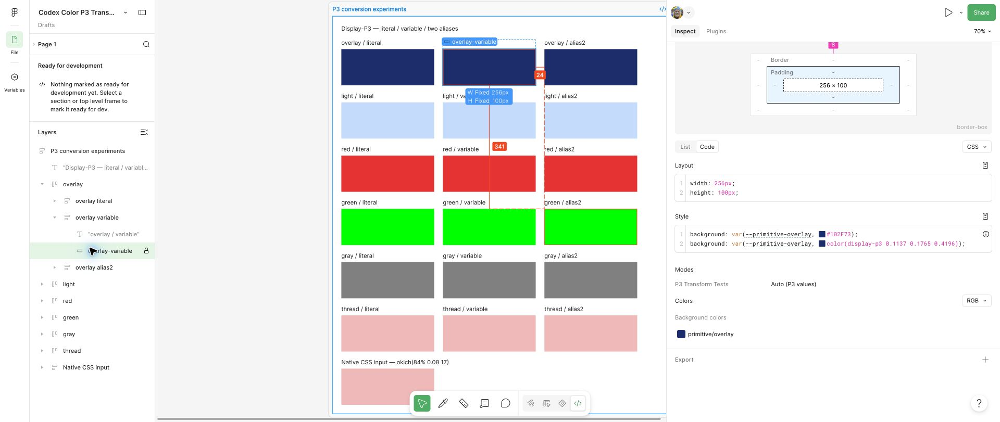

# Записи цвета в интерфейсе Figma

Одинаковая строка `#RRGGBB` в Figma и CSS может обозначать разные цвета. Для интерпретации нужны место вывода и цветовой профиль документа. Этот справочник объясняет записи в Variables, color picker, Dev Mode, JSON и Plugin API на основе прогонов 14 и 15 октября 2026 года.

Практические выводы относятся к проверенным SOLID-заливкам, локальным COLOR-переменным и алиасам. Описание стандарта CSS отделено от наблюдённого поведения Figma.

## Профиль, прямая заливка и алиасы

Цветовой профиль задаёт смысл RGB-каналов. В документе Display-P3 числа интерпретируются как P3, в документе sRGB — как sRGB. Само слово HEX обозначает способ записи чисел, а не профиль. В CSS профиль HEX установлен стандартом: это sRGB. [CSS Color 4](https://www.w3.org/TR/css-color-4/#hex-notation).

Прямая заливка — цвет, заданный непосредственно у слоя без привязки к переменной. Например, в **Fill** прямоугольника введён конкретный цвет. Заливка через переменную получает цвет из COLOR-переменной; два слоя с разными способами задания могут иметь одинаковые исходные каналы.

Алиас — переменная, значение которой ссылается на другую переменную. В исходном тестовом файле использована цепочка:

```text
role/overlay
    → semantic/overlay
        → primitive/overlay
            → числовое RGBA
```

Разрешить алиас означает пройти по ссылкам до конечного цвета с учётом режима. В таблице Variables значение относится к просматриваемому режиму; для конкретного слоя дополнительно учитывается режим потребителя. Сам алиас не означает преобразование цветового пространства. В наших опытах цепочка из двух алиасов дала тот же CSS-fallback, что и примитивная переменная. [Состояние исходного файла](../research/2026-10-14/evidence/figma-state.json).

## Значение записей в разных местах

Таблица 1. Представления цвета

| Место | Что означает запись | Особенность переноса в код |
| :--- | :--- | :--- |
| HEX в таблице **Variables** | Округлённые RGB-каналы переменной в профиле документа; для алиаса — конечный цвет просматриваемого режима | В P3-файле это P3 HEX. Вставка тех же символов в CSS задаёт sRGB-цвет |
| HEX в **color picker**, формат **Hex** | Округлённые каналы редактируемого цвета в профиле документа | HEX может скрывать более точные дробные каналы. Формат **CSS** рассматривается отдельно |
| HEX в **Dev Mode → CSS**, прямая заливка | CSS sRGB-цвет. В проверенных опытах результат согласован с одним преобразованием P3 → sRGB, clipping и округлением | Описывает резервный цвет в sRGB |
| HEX в **Dev Mode → CSS**, заливка через переменную | CSS sRGB-цвет по смыслу записи, но наблюдённые числа отличаются от однократного преобразования исходного P3 | Совпал с моделью двух проходов; для переноса исходного цвета требуется отдельный пересчёт |
| `color(display-p3 r g b)` в **Dev Mode** | CSS-цвет с явно указанным Display-P3; нелинейные каналы выведены с округлением | В опытах соответствовал исходным P3-каналам с точностью вывода, а не HEX-fallback переменной |
| `var(--name, …)` в **Dev Mode** | Ссылка на CSS-переменную и её резервное значение | Имя не определяет числовой цвет. Значение внутри CSS-переменной в приложении может отличаться от резервного |

Figma различает модель записи и профиль: переключение Hex, RGB, HSL или CSS в палитре меняет представление, а профиль влияет на интерпретацию цвета. [Справка Figma о моделях](https://help.figma.com/hc/en-us/articles/360043042113-About-color-models). Правила смены профиля **Assign** и **Convert** описаны в [справке о профилях](https://help.figma.com/hc/en-us/articles/360039825114-Manage-color-profiles-in-design-files); смена профиля не используется как способ исправления CSS-fallback.

## Один цвет в разных представлениях

Для исследованного Overlay в P3-файле сохранены float32-каналы, близкие к `(29, 45, 107) / 255`. Ниже приведён именно образец после HEX-ввода. Ввод исходного OKLCH через CSS-поле может дать тот же табличный HEX при других, более точных каналах.

Таблица 2. Представления Overlay

| Источник | Значение |
| :--- | :--- |
| HEX в Variables и палитре в формате Hex | `#1D2D6B` |
| Исходные каналы, Plugin API или JSON | `[0.11372549086809158, 0.1764705926179886, 0.41960784792900085]` |
| P3-строка Dev Mode | `color(display-p3 0.1137 0.1765 0.4196)` |
| HEX прямой заливки в Dev Mode | `#182E6F` |
| HEX-fallback переменной в Dev Mode | `#102F73` |

В таблице Variables этот цвет виден вместе с результатами других способов ввода.


Рисунок 1. HEX переменных после обновления страницы

Dev Mode показывает резервный HEX и P3-строку для той же привязанной переменной.



Рисунок 2. CSS-fallback и P3-представление переменной Overlay

`#102F73` не является результатом одного преобразования исходного P3 в sRGB с clipping. Один проход даёт `#182E6F`, и для этого синего все sRGB-каналы уже находятся в диапазоне от 0 до 1: clipping ничего не меняет. Расчёты и сравнение с прямой заливкой находятся в [исследовании Dev Mode](dev-mode-fallback.md).

## Округление и точность

Для шестизначного HEX каждый канал умножается на `255` и округляется до ближайшего целого от `0` до `255`. Целое записывается двумя шестнадцатеричными цифрами. Расчётная утилита использует `Math.round(channel * 255)`; поведение Figma ровно на половине шага отдельно не проверялось.

```text
0.113725490868… × 255 → 29  → 1D
0.176470592618… × 255 → 45  → 2D
0.419607847929… × 255 → 107 → 6B
Результат: #1D2D6B
```

В P3-строке проверенного Dev Mode каналы округлены до четырёх знаков после десятичной точки. Например, `0.176470592618…` выведен как `0.1765`. Это округление отображения, а не округление сохранённого значения до четырёх знаков.

Таблица 3. Разные виды точности

| Представление | Точность |
| :--- | :--- |
| Исходное значение переменной в архиве | Дробные каналы float32; это не обязательно байты, делённые на 255 |
| Шестизначный HEX | 8 бит на канал, шаг `1/255` |
| P3-строка проверенного Dev Mode | До четырёх знаков после точки, десятичный шаг `0.0001` |

При сравнении используются сохранённые числа. Например, double `0.9` при умножении на `255` даёт `229.5`, а сохранённый float32 `0.8999999761581421` — число чуть меньше `229.5`. В нашей утилите они округляются в `230` и `229` соответственно. Это различие точности входа; оно не доказывает правило Figma на точной половине. Пограничные случаи десятичного округления Dev Mode также отдельно не проверялись.

## Два прохода в модели Dev Mode

Один проход — преобразование P3-каналов в sRGB, обрезание каналов до диапазона от 0 до 1 и округление до байт. В модели двух проходов результат первого прохода повторно принимается за P3-каналы и преобразуется в sRGB ещё раз:

```text
Исходные P3-каналы, HEX #1D2D6B
    → преобразование P3 → sRGB, clipping, округление до байт
    → [24, 46, 111], CSS HEX #182E6F
    → повторная интерпретация [24, 46, 111] / 255 как P3
    → преобразование P3 → sRGB, clipping, округление до байт
    → [16, 47, 115], CSS HEX #102F73
```

Между проходами меняется интерпретация чисел: sRGB-числа используются как P3. Это не обратное преобразование sRGB → P3 и не дополнительный проход для каждого алиаса. Модель воспроизводит сохранённые результаты, но не является описанием проверенного внутреннего кода Figma. [Сравнение моделей и уровень подтверждения](dev-mode-fallback.md).

## CSS-поле, экспорт JSON и Plugin API

В CSS-поле палитры пространства могут задаваться явно: `color(display-p3 …)`, `color(srgb …)` или `oklch(…)`. Этот способ ввода отличается от HEX-поля. В наших опытах ввод OKLCH в P3-переменную сохранял более точные каналы, чем шестизначный HEX; после обновления исходная текстовая запись могла замениться другим представлением. Сохранение цвета и сохранение текста проверяются отдельно. [Ввод из кода](code-to-figma.md).

Штатный P3-экспорт Variables сохранял P3-числа в `components` и округлённые P3-байты в `hex`, но указывал `colorSpace: "srgb"`. Поэтому в этом пути метка не подтверждает преобразование чисел в sRGB. Для стандартного DTCG смысл полей другой; JSON-экспорт Figma нельзя интерпретировать без проверки профиля. В парном импорте `colorSpace: "display-p3"` вызвал ошибку во всех восьми проверках, а `srgb`-контроли сохранили переданные числа. [Подробности JSON](variables-json.md).

Plugin API возвращает дробные `r`, `g`, `b`, `a`. Для интерпретации сохраняются профиль, fileKey, режим и ID переменной. При привязанной заливке `paint.color` не заменяет разрешённое значение переменной для слоя: в исходном архиве эти поля иногда различались. [Чтение цвета и разрешение алиасов](figma-to-code.md).

## Альфа и выбор источника для кода

Шестизначный HEX не содержит альфу. Figma документирует также восьмизначный `#RRGGBBAA` и отдельное поле прозрачности; ввод альфы через HEX в наших опытах отдельно не проверялся. Альфа переменной, opacity заливки и opacity слоя или группы относятся к разным уровням. Один RGB-код не определяет окончательный цвет пикселя на фоне. [Прозрачность и color-mix](opacity-and-color-mix.md).

Для точного переноса исходного цвета используются дробные каналы разрешённой переменной с подтверждённым профилем. P3-строка Dev Mode уже содержит пространство, но округлена. Табличный HEX теряет часть точности, а HEX-fallback переменной в проверенной среде требует отдельного пересчёта. Для sRGB-резерва задаётся явная политика охвата. [Инструкция переноса в код](figma-to-code.md).

Снимки экрана подтверждают слой и значения интерфейса. Измеренный пипеткой пиксель не заменяет исходные каналы: на него влияют фон, прозрачность и отображение. Растровый экспорт, пипетка и разные физические дисплеи этим исследованием не проверялись. Полные данные и ограничения находятся в [каталоге тестов](test-catalog.md) и [отчёте повторного прогона](../research/2026-10-15/replication-01/README.md).
