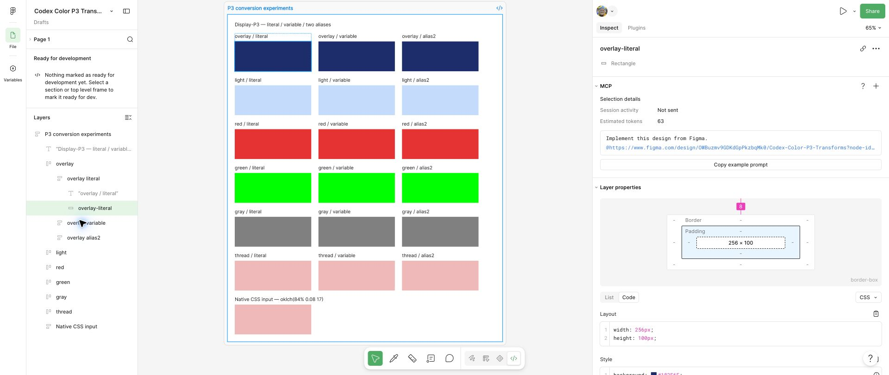

# HEX-fallback переменных в Dev Mode

В браузерном Dev Mode от 14.10.2026 одинаковые непрозрачные P3-заливки дали разные sRGB HEX-fallback в зависимости от привязки. Путь прямой заливки согласован с однократным преобразованием и clipping. Путь переменной совпал с численной моделью двойного преобразования.

В [повторном прогоне от 15.10.2026](../research/2026-10-15/replication-01/README.md) предсказания зафиксированы до создания тестовых файлов. Наблюдения на всех 21 слоях совпали с предсказаниями: четыре новых цвета и три контроля, каждый с прямой заливкой, переменной и двумя алиасами. Новые цвета C и D различают модель двух проходов и альтернативу с предварительным округлением P3 до байт. Два чтения выполнены тем же агентом; слепой независимой экспертизой они не являются.

## Наблюдения интерфейса

Прямая заливка — цвет, заданный непосредственно у слоя без привязки к переменной. Примитивная переменная хранит числовое RGBA. Алиас — переменная со ссылкой на другую переменную; в этом опыте роль ссылается на semantic, а semantic — на примитив. Подробные определения и различия записей находятся в [справочнике интерфейса Figma](color-notations.md).

Для каждого из шести цветов созданы три прямоугольника: прямая SOLID-заливка, примитивная COLOR-переменная и роль с двумя последовательными алиасами. Исходные RGB-каналы у трёх вариантов одного цвета совпадают.

Таблица 1. sRGB HEX-fallback из браузерного Dev Mode

| Образец | Прямая заливка | Переменная | Два алиаса |
| :--- | :--- | :--- | :--- |
| Overlay | `#182E6F` | `#102F73` | `#102F73` |
| Light | `#BEDCFF` | `#B6DDFF` | `#B6DDFF` |
| Red | `#FA0525` | `#FF0005` | `#FF0005` |
| Green | `#00FF00` | `#00FF00` | `#00FF00` |
| Gray | `#808080` | `#808080` | `#808080` |
| Цвет из треда | `#FAB6B8` | `#FFB2B7` | `#FFB2B7` |

P3-строка для Overlay в трёх случаях имеет каналы `0.1137 0.1765 0.4196`. Значение переменной не заменилось на sRGB HEX: расхождение относится к резервному значению в сгенерированном CSS.

В этой P3-строке Dev Mode округляет каналы до четырёх знаков после десятичной точки: например, `0.176470592618… → 0.1765`. Это точность отображения; исходные числа сохраняются отдельно. Правило для значений ровно посередине между соседними десятичными шагами отдельно не проверялось.

Прямая заливка и переменная зафиксированы отдельными снимками.



Рисунок 1. Прямая заливка и sRGB-fallback #182E6F


Рисунок 2. Переменная и sRGB-fallback #102F73

## Численная модель

Проход в этой модели — преобразование P3 → sRGB с clipping и округлением до байт. Два прохода означают, что полученные после первого преобразования sRGB-числа повторно интерпретируются как P3 и ещё раз преобразуются в sRGB. Это не обратное преобразование sRGB → P3 и не отдельное преобразование для каждого алиаса.

Модель для переменной состоит из следующих операций:

1. Преобразование исходных P3-каналов в sRGB.
2. Обрезание sRGB-каналов до диапазона от 0 до 1.
3. Округление каналов до 8 бит.
4. Интерпретация полученных байтов, делённых на 255, как новых P3-каналов.
5. Повторное преобразование в sRGB.
6. Обрезание и округление итоговых каналов.

Clipping заменяет числа меньше `0` на `0`, больше `1` — на `1`. Затем расчётная модель использует `Math.round(channel * 255)`: округляет до ближайшего целого байта. Для следующего прохода байт делится на `255`. Совпадение модели с наблюдениями не устанавливает правило самой Figma на точной половине шага округления.

Для Overlay вычисления дают:

```text
P3 #1D2D6B
→ sRGB [0.09420909, 0.17861373, 0.43556460]
→ RGB [24, 46, 111], HEX #182E6F
→ повторная интерпретация [24, 46, 111] / 255 как P3
→ sRGB [0.06142425, 0.18311594, 0.45197953]
→ RGB [16, 47, 115], HEX #102F73
```

Для этого образца оба прохода остаются внутри sRGB. Расхождение вызвано повторным преобразованием, а не clipping. Промежуточное округление имеет значение: без него второй проход даёт `#102E73`.

Модель совпала с HEX-fallback всех шести образцов. Gray и Green являются контрольными случаями, где два способа дают одинаковый итоговый HEX; они сами по себе не различают гипотезы.

## Уровень подтверждения

Подтверждено прямым наблюдением UI: одинаковая заливка меняет HEX-fallback после привязки к переменной, а цепочка двух алиасов даёт тот же результат, что и примитивная переменная.

Подтверждено расчётом по исходному архиву: шесть результатов совпадают с моделью двух проходов с промежуточным округлением. Четыре образца различают один и два прохода; Gray и Green дают одинаковый HEX и служат контролями. В прогоне от 14.10.2026 подбор и проверка выполнены на одном наборе. Проверка предсказаний на новых цветах выполнена отдельно 15.10.2026 и описана ниже.

Таблица 2. Дополнительные расчёты на исходной выборке

| Образец | Три прохода | Четыре прохода | Два без промежуточного округления | Округление P3 на входе, затем два прохода |
| :--- | :--- | :--- | :--- | :--- |
| Overlay | `#003077` | `#00317C` | `#102E73` | `#102F73` |
| Light | `#ACDEFF` | `#9EE0FF` | `#B7DDFF` | `#B6DDFF` |
| Red | `#FF0000` | `#FF0000` | `#FF0004` | `#FF0005` |
| Green | `#00FF00` | `#00FF00` | `#00FF00` | `#00FF00` |
| Gray | `#808080` | `#808080` | `#808080` | `#808080` |
| Цвет из треда | `#FFAEB6` | `#FFA9B5` | `#FFB2B6` | `#FFB2B7` |

В каждом проходе выполняется clipping sRGB. В колонке без промежуточного округления каналы остаются дробными до финального HEX. В последней колонке P3 дополнительно округляется до байт перед первым проходом. Три и четыре прохода совпадают с наблюдением только на двух контролях. Для расчёта используются сохранённые float32-каналы, а не исходные литералы из `cases.json`. Предварительное округление P3 совпадает с текущей моделью на всех шести сохранённых образцах, поэтому исходный архив не различает эти варианты. Для Red исходный double `0.9` округляется в байт 230, а сохранённый float32 `0.8999999761581421` — в 229; из-за этого расчёт по исходному литералу дал бы другой результат. Точность ввода и версии реализации существенны, а совпадение не устанавливает единственный возможный внутренний механизм.

Не установлено: внутреннее место ошибки, конкретная реализация преобразования в Figma, влияние всех библиотечных переменных и других видов заливки. Совпадение результатов не является аудитом внутреннего кода Figma.

## Проверка архивных данных

Чтобы проверить сохранённую модель:

1. Откройте каталог репозитория.
2. Выполните команду:

   ```sh
   npm run verify
   ```

Команда сверяет модель с сохранённым CSS из UI и исходными значениями. Для проверки текущей версии Figma нужен [новый практический прогон](research-methodology.md).

## Повторная проверка с предрегистрацией

В [новом прогоне](../research/2026-10-15/replication-01/README.md) предсказания зафиксированы до создания файла, оба чтения — до сравнения. Все 21 результата семи цветов совпали с предсказаниями: четыре новых цвета и три контроля, каждый с тремя способами заливки. На новых C и D предварительное округление P3 до байт даёт другой HEX, поэтому новая выборка различает эту альтернативу. Проверка описывает поведение в записанной среде; внутренний код Figma по-прежнему не исследован.
