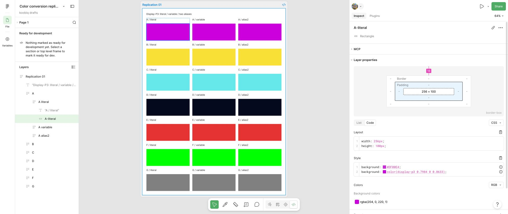
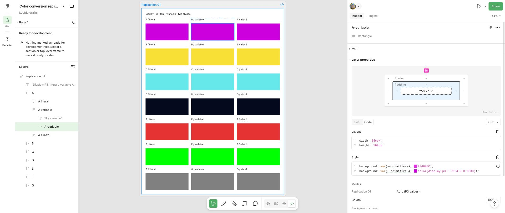

# Повторная проверка после ревью

Прогон завершён 15 октября 2026 года: Dev Mode проверен на всех 21 слоях, выполнены все 16 опытов парного импорта, сохранены две штатные локальные `.fig`-копии. Исходные архивы прежних прогонов не изменены.

Предрегистрация опубликована в коммите `25fb09f0671075580319577da470b2beab236658`, до создания файлов. Два чтения Dev Mode зафиксированы коммитом `04f4d90` до первого сопоставления с предсказаниями. [comparison.json](comparison.json) содержит отдельный последующий расчёт.

## Полученные результаты

Все 21 значения Dev Mode совпали с предсказаниями: четыре новых цвета и три контроля, каждый с прямой заливкой, переменной и двумя алиасами. Образцы A–D не участвовали в исходном подборе модели. Три способа привязки одного цвета не являются тремя независимыми цветовыми образцами.

| Образец | Прямая заливка | Переменная и два алиаса |
| :--- | :--- | :--- |
| A, после предварительного clipping P3 | `#DF00E4` | `#F400EC` |
| B | `#FEDF00` | `#FFDE00` |
| C | `#00EBEC` | `#00EFEE` |
| D | `#030920` | `#020922` |
| E, Red | `#FA0525` | `#FF0005` |
| F, Green | `#00FF00` | `#00FF00` |
| G, Gray | `#808080` | `#808080` |

Значения `#0F0` нормализованы в таблице до `#00FF00`. Два чтения согласованы для всех 21 слоёв. Варианты трёх и четырёх проходов отличаются от наблюдения на всех четырёх новых цветах. Предварительное округление P3 до байт перед двумя проходами различается с наблюдением на C и D; исходная выборка от 14 октября эту альтернативу не различала, если считать по сохранённым float32-каналам.

В P3-документе выполнены восемь импортов: два цикла пар `srgb` и `display-p3`, отдельно для double и float32. Все `srgb`-контроли обновили одну переменную `VariableID:2:97`; все `display-p3` сообщили ошибку и сохранили точный контроль. В sRGB-документе оба цикла на `VariableID:1:3` дали тот же результат: четыре обновления `srgb` и четыре ошибки `display-p3` с сохранением контроля. Итого — восемь успешных положительных контролей и восемь пропущенных P3-записей в 16 опытах. Во всех случаях проверены точный RGBA до импорта, имя и ID цели, уведомление и штатный повторный экспорт.

Источники: [первое чтение](evidence/devmode-reading-1.json), [визуальное повторное чтение](evidence/devmode-reading-2.json), [фиксация чтений](evidence/readings-freeze.json), [метаданные среды](metadata.json).

Рисунок 1. Читаемая панель CSS прямой заливки A

Рисунок 2. Читаемая панель CSS переменной A

Предрегистрация сохраняется отдельным коммитом до открытия нового файла Figma. После фиксации `predictions.json`, `protocol.json` и файлы `imports` не изменяются. Контрольные суммы находятся в `preregistration-hashes.json`; наблюдения добавляются в `evidence` отдельно.

## Dev Mode

Четыре новых цвета обозначены A–D; E–G — контрольные Red, Green и Gray. Каждому соответствуют прямая заливка, примитивная переменная и два алиаса: всего 21 слой. Исходный OKLCH переводится в P3, каналы обрезаются до диапазона от 0 до 1, затем округляются до float32. Эти точные числа передаются через Plugin API, без HEX-ввода. Сохранённые каналы проверяются отдельно.

Для образца A требуется clipping P3 до создания слоя. Предсказания для необрезанных координат сохранены только как контрфактический расчёт. Они не заменяют предсказания для реально вводимых чисел.

Сравниваются один, два, три и четыре прохода с clipping и округлением sRGB после каждого прохода; отдельно — два прохода без промежуточного округления и округление исходного P3 до байт перед двумя проходами. Матрица находится в [predictions.json](predictions.json).

Первое чтение CSS сохраняется из UI, второе — из снимков. Оба чтения фиксируются до запуска сравнения с матрицей. Повторное чтение тем же агентом не является слепой независимой экспертизой; это ограничение указывается в итоговом отчёте.

## Парный импорт

В каждом профиле используется одна переменная `color-space-probe`. Внутри пары JSON отличается только `colorSpace`. Для двойной точности и float32 подготовлены отдельные пары. Перед каждым импортом переменная сбрасывается в точный контрольный RGBA, записанный в [protocol.json](protocol.json). В каждом профиле предусмотрены два цикла, по четыре импорта в цикле: всего 16 опытов. Фактически выполнены все 16 опытов; [реестр тестов](test-registry.json) связывает каждый с исходным JSON, контрольным состоянием, UI-уведомлением и повторным экспортом.

Сохраняются исходный RGBA, имя и ID, уведомление UI, результат и повторный экспорт. Вывод о пропуске допускается только при успешном парном `srgb`-контроле на той же переменной. Предсказания о результате импорта пока не являются наблюдениями.

## Среда и архив

До сбора фиксируются ОС, браузер, Node.js, версия Color.js и доступная версия Figma. Отсутствующий номер веб-сборки записывается как недоступный с указанием способа проверки. Новый файл и профиль подтверждаются отдельно. Исходные архивы от 14 и 15 октября не изменяются.

Сценарий [preregister-replication.mjs](../../../scripts/preregister-replication.mjs) воспроизводит подготовку и запрещает перезапись существующего каталога. Для нового исследования требуется отдельный каталог и новая предрегистрация.

## Изменения условий и ограничения

Файлы созданы в ранее выбранной личной команде Starter. После ограничения MCP и экрана Upgrade в Dev Mode пользователь разрешил Pro-команду `john.lindsey.mail1's team`; файлы перенесены в проект `koobiq drafts` с прежними ключами. Профили, входные координаты и предсказания сохранены. Поэтому P3-импорт и Dev Mode выполнены на разных этапах размещения файла; это указано в метаданных.

При подготовке sRGB-опыта UI-функция сбросила переменную прежней P3-вкладки. Проверка экспортного RGBA остановила опыт до импорта. [Экспорт ошибки подготовки](evidence/preparation-error-wrong-tab-reset.tokens.json) сохранён отдельно и не включён в матрицу. Сброс не затронул 21 образец Dev Mode. В последующих UI-функциях вкладка передаётся явно.

Первый набор снимков `devmode-*.png` в некоторых случаях обрезает нижнюю часть CSS: после навигации раскрывался блок MCP. Эти изображения не использованы для визуального повторного чтения. Дополнительный набор `second-*.png` снят с расширенной панелью и свёрнутым блоком MCP; имя слоя и обе строки CSS видимы. Исходные снимки и текстовые наблюдения сохранены.

Повторное чтение выполнено тем же агентом, без слепого разделения исследователей. Внутренний код Figma не проверялся. Браузер и ОС записаны; точный номер развёрнутой веб-сборки Figma в изученном Help не найден. Проверка в другой версии браузера не выполнялась.

Чтобы проверить имеющийся архив, используется `npm run verify:replication`. Команда требует полной матрицы из 16 опытов и согласованного реестра из 37 тестов. Во время сбора архив содержал 9 опытов, и проверка с `--require-complete` отклоняла его как неполный. Проверка читает сохранённые данные и не запускает Figma.

## Локальные файлы и реестры

| Профиль | Файл Figma | Локальная копия | Узлы со страницей | Переменные |
| :--- | :--- | :--- | :--- | :--- |
| Display-P3 | [P3-документ](https://www.figma.com/design/2i0faqAmzqkPPD8Zsc0iMW?node-id=2-11&m=dev) | [Replication-01-P3.fig](figma/Replication-01-P3.fig) | 73 | 22 |
| sRGB | [sRGB-документ](https://www.figma.com/design/xHj0Mhhmm4Vd7RsjyXuOZj?node-id=0-1) | [Replication-01-sRGB.fig](figma/Replication-01-sRGB.fig) | 1 | 1 |

В P3-файле находятся 21 прямоугольник, 21 переменная основного набора и отдельная переменная импорта. sRGB-файл содержит страницу и одну переменную; образцы Dev Mode в нём не создавались. [Реестр узлов](node-registry.json) использует пару fileKey и nodeId. [Реестр тестов](test-registry.json) содержит 21 наблюдение Dev Mode и 16 импортов; три слоя одного цвета не считаются независимыми цветовыми образцами.

Локальные копии получены через **File → Save local copy**. Системные **Open** и **Save** выполнены через computer-use. ZIP-контейнеры, CRC всех записей, размеры, SHA-256, название исходного файла и время экспорта проверены. Бинарный `canvas.fig` не декодировался; обратный импорт этих двух новых копий в данном прогоне не выполнялся. Записанные ID относятся к исходным тестовым файлам. При последующем восстановлении требуется отдельно проверить соответствие ID.

## Повторение архивных проверок

Требуются Node.js 22 или выше, npm и Python 3 со стандартной библиотекой для проверки ZIP/CRC.

Чтобы проверить сохранённый прогон:

1. Выполните `npm ci` в корне репозитория.
2. Выполните `npm run verify:replication`.
3. Выполните `npm run verify:replication:copies`.
4. Выполните `npm test` и `npm run check:links`.

Первая проверка сверяет контрольные суммы, неизменность предрегистрации и чтений, значения и привязки 21 слоя, обе транскрипции CSS, все варианты модели, 16 парных импортов и реестры. Вторая отдельно открывает оба ZIP-контейнера `.fig` и проверяет CRC, SHA-256 и метаданные. Ни одна команда не выполняет живой импорт в Figma. Точные численные сравнения доступны в [comparison.json](comparison.json), контрольные суммы всех файлов — в [manifest.json](manifest.json).

Для нового исследования используется новый каталог. При добавлении производных файлов в текущий архив манифест обновляется через `node scripts/update-replication-manifest.mjs`. Пересчёт отчёта выполняется через `node scripts/verify-replication.mjs --write-report`, затем обновляется манифест и запускаются проверки. Это служебные команды записи; штатный CI только читает архив. Предрегистрация, исходные наблюдения и замороженные чтения при пересчёте не изменяются.
